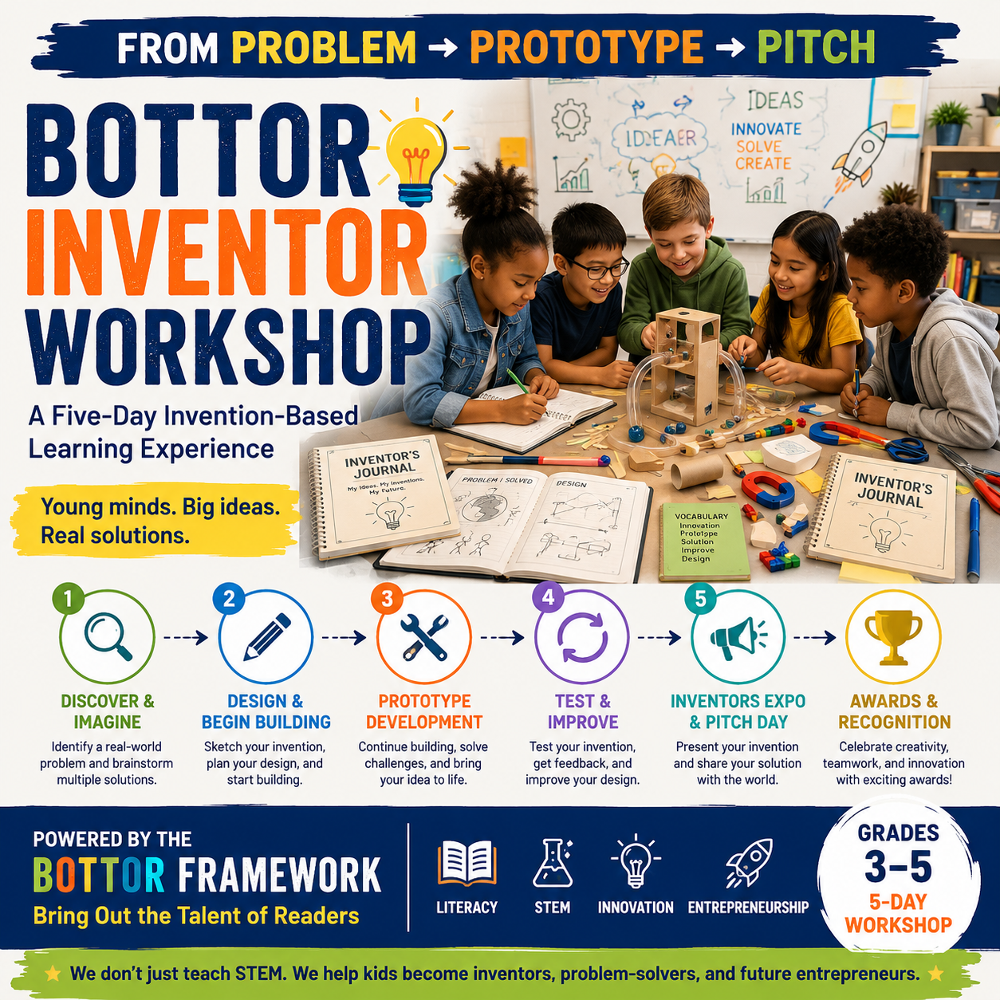

# Bottor Learning Foundation — Corporate Sponsorship Packet
### Sponsor the Bottor Inventor Workshop

> *"The Bottor Inventor Workshop is a five-day invention-based learning experience where students identify real-world problems, build prototypes, strengthen literacy, and present innovative solutions."*

This is the reusable base packet for approaching corporate and business sponsors. It's written to be copied and adapted per company — swap in the sponsor's name, adjust tier language to match the conversation, and trim to one page before sending. See the checklist at the bottom before this goes out the door for the first time.

---

## About Bottor Learning Foundation

Bottor Learning Foundation is a Wisconsin-based 501(c)(3) nonprofit (EIN 41-3321544) whose mission is to advance literacy, innovation, and STEM through invention-based learning that empowers young inventors, creative problem-solvers, and future entrepreneurs.

## The Bottor Inventor Workshop, at a Glance

- **A five-day, hands-on invention curriculum** for students in grades 3–5 (ages 8–11)
- Students identify a real problem, design and build a prototype, test and refine it, and pitch it publicly — from Discover & Imagine on Day 1 to the Inventors Expo & Pitch Day on Day 5
- Guided by **The BOTTOR Framework** and **Professor WiggleWoo**, our inventor-mentor character, with literacy woven into every day through the Innovation Vocabulary Challenge
- Delivered flexibly: foundation-hosted cohorts, in-school residencies, library and community-center workshops, and after-school/weekend formats
- Every cohort ends in a public **Inventors Expo**, where students showcase their prototype, Inventor's Journal, and pitch to parents, teachers, and community members

## Why Sponsor This Program

- **A concrete, credible curriculum** — not a vague "STEM outreach" claim. Sponsors can point to exactly what their dollars fund: prototype materials, a printed Inventor's Journal, a facilitator, a seat.
- **Visible community presence** at each cohort's Inventors Expo — a public event with parents, teachers, and community members in attendance.
- **Employee engagement opportunities** — judging Pitch Day presentations, helping assemble materials kits, or mentoring a team's Research or Testing Lead.
- **A direct line to future talent and civic goodwill** — introducing children to invention, problem-solving, and entrepreneurship early, in the sponsor's own community.

## Sponsorship Tiers *(baseline — adjust dollar amounts and benefits to match the actual conversation)*

| Tier | Suggested Level | What It Funds | Recognition |
|---|---|---|---|
| **Community Partner** | $500+ | Prototype materials for one team | Name listed on event signage and social media |
| **Innovation Partner** | $1,500+ | Materials and Inventor's Journals for a full cohort | Logo on cohort materials; recognition at that cohort's Inventors Expo; one employee volunteer slot at Pitch Day |
| **Founding Partner** | $5,000+ | An entire workshop cohort — materials, journals, and facilitator costs — for a partner school or library | Premier recognition across the season; VIP invitation to every Expo that season; named as a Founding Partner |

## Contact / Next Steps

To discuss a sponsorship, contact us through the website's contact form (select "Donation Question" or "General Inquiry") or email **info@bottorlearningfoundation.org**.

**Mailing address** (for checks or mailed materials):
Bottor Learning Foundation
11411 W. Park Place, Suite 202
Milwaukee, WI 53224

---

## Before Sending This Packet — Checklist

1. **No sponsor-recognition page exists on the website yet.** Before promising "logo on our website" or "listed as a sponsor," either build that page or adjust the benefit to something currently deliverable (event signage, social media, an Expo mention).
2. **Tax-deductibility of sponsorships with benefits.** Unlike a straight donation, a sponsorship that includes tangible benefits (logo placement, event recognition) may only be tax-deductible for the portion exceeding fair market value of those benefits. Confirm the correct language with Sharlane Gunn (Treasurer) before quoting deductibility to a sponsor — don't reuse the site's blanket "your donation is tax-deductible" line here without checking.
3. **HQ mailing address** — resolved: 11411 W. Park Place, Suite 202, Milwaukee, WI 53224 (see Contact / Next Steps above). Use this for any "mail a check to" ask; never substitute an event venue address.
4. **Real photos** — this packet reads better with an actual Inventors Expo photo once one exists; swap in as soon as the first cohort runs.
5. **Confirm current cohort schedule** before naming a specific Expo date to a prospective sponsor.
